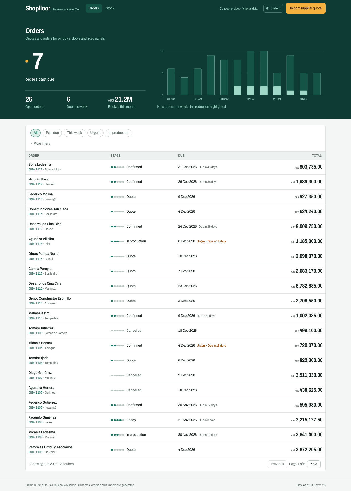
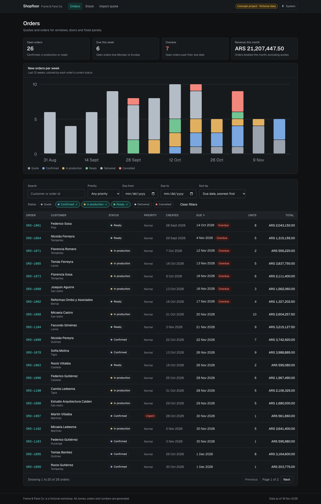
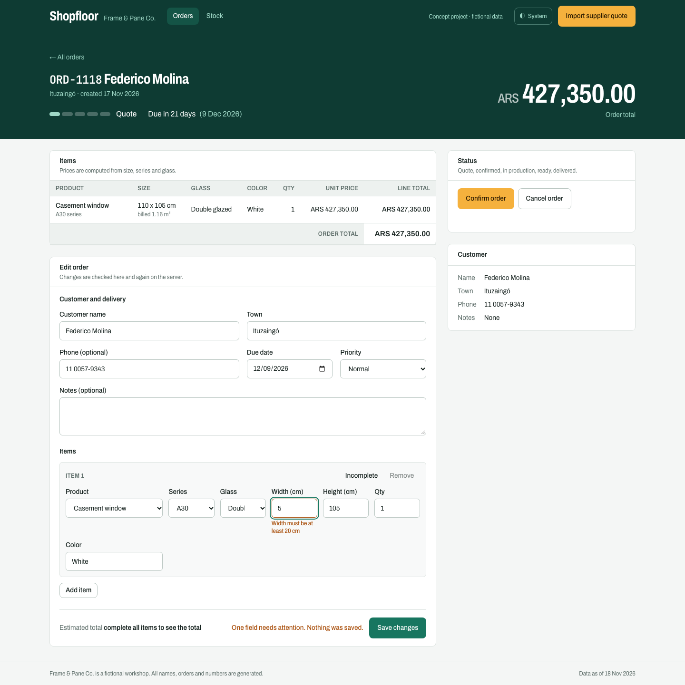
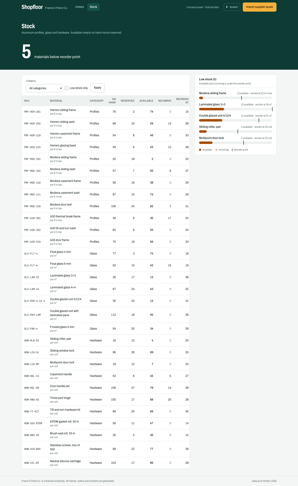
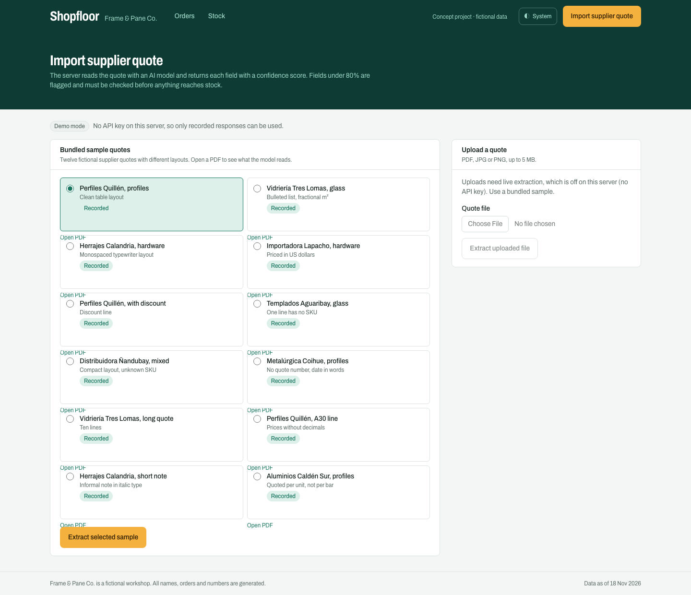
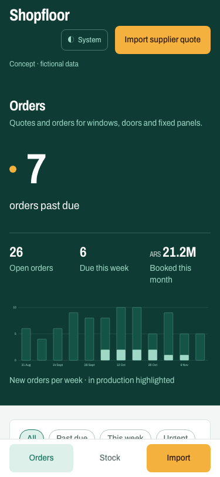
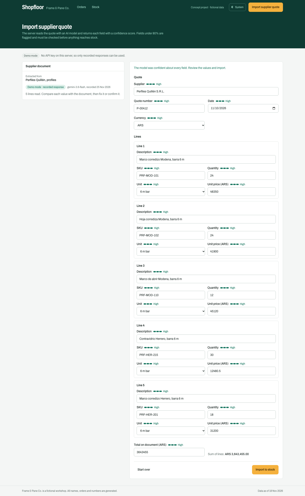
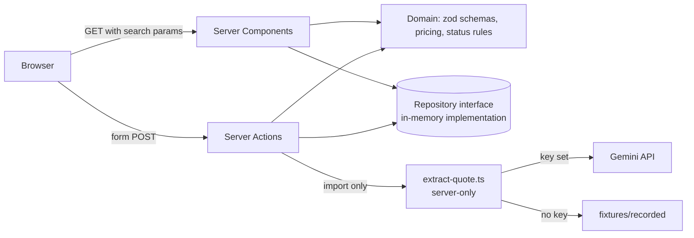

# Shopfloor

An operations dashboard for Frame & Pane Co., a small aluminum window and door workshop: orders, stock, and importing supplier quotes with an AI model and a human review step.

> **Concept project · fictional data / not client work.** Frame & Pane Co., its customers, suppliers, orders and numbers are invented and generated. It was built as a portfolio piece by Pablo Esteban Fernandez.

## Screenshots

| Orders | Orders, dark mode |
| --- | --- |
|  |  |

| Order detail with a validation error | Stock |
| --- | --- |
|  |  |

| Import, choosing a sample | Phone |
| --- | --- |
|  |  |

| Import, review screen |
| --- |
|  |

Screenshots are taken from the production build with `pnpm screenshots`.

## What it does

- **Orders** (`/orders`): a large past due count at the top, with open orders, orders due this week and money booked this month beside it, and a chart of new orders per week for the last 12 weeks. Quick filter chips (All, Past due, This week, Urgent, In production) sit above a table with search, status, priority, due date range, sorting and pagination. Each row shows a five-step stage bar next to the status name. On phones every order becomes a card. Every filter lives in the URL, so links can be shared and back and forward work.
- **Order detail** (`/orders/ORD-1042`): items with prices computed from size, aluminum series and glass; an edit form for customer, due date, priority, notes and items, validated in the browser and again on the server with the same schema; buttons for the legal next status only.
- **Stock** (`/stock`): materials with on hand, reserved, available and incoming quantities, a low stock filter and a chart of low items against their reorder point.
- **Import a supplier quote** (`/imports/new`): upload a PDF or image, or pick one of 12 bundled sample quotes. The server extracts the quote with Gemini, the user checks every low-confidence field, and matched lines are added to incoming stock. Lines that cannot be matched are listed with the reason.

## Architecture



- `src/domain/`: framework-free TypeScript. Zod schemas are the source of truth and types are inferred from them. Pricing, the status state machine, stock math, KPI math and the URL query format live here and are unit tested.
- `src/server/`: the repository interfaces and the in-memory implementation with seeded data, read helpers for pages, and the AI extraction code.
- `src/app/`: routes, Server Actions and the client components that need interactivity (filter bar, edit form, status buttons, import flow).
- `src/components/ui/`: small typed components (Button, Field, Select, Badge, Card, Table, Dialog). No component library.

Money is stored as integer cents in ARS and formatted with `Intl`. Order totals are always computed from items, never stored.

## Engineering decisions

- [ADR 1: Keep list filters in the URL](docs/adr/0001-url-as-state.md)
- [ADR 2: Server Components and Server Actions instead of a client data cache](docs/adr/0002-server-actions-over-client-cache.md)
- [ADR 3: In-memory repository behind an interface](docs/adr/0003-in-memory-repository.md)
- [ADR 4: Validating AI extraction and keeping a person in the loop](docs/adr/0004-ai-extraction-validation.md)

Charts are plain SVG and HTML instead of a chart library. There are two small charts, and drawing them by hand keeps the bundle small and lets them use the same color tokens as the rest of the UI. Each chart also has the numbers as text for screen readers.

## Testing

| Layer | Tool | What is covered |
| --- | --- | --- |
| Unit | Vitest | Pricing, status transitions, stock math, KPIs, dates, zod schemas, URL query parsing, seed data and repository filtering, sorting and paging, line matching, rate limiter, eval scorer, JSON schema conversion |
| Integration | Vitest | Extraction validation and retry with the Gemini SDK mocked (valid answer, retry with errors in the prompt, second failure, SDK error, missing key), replay of recordings |
| Component | Vitest + Testing Library | Filter bar writes the right URLs (status, priority, sort, debounced search, clear); review form flags low-confidence fields and blocks import until they are checked |
| End to end | Playwright (Chromium) | Filter orders and check URL and rows, reload keeps filters, back undoes; search, sort and paging; edit an order, hit a validation error, fix it, save and see the new total; legal status change; cancel with a confirmation dialog; demo import without recordings; axe checks on every page in light and dark mode; no horizontal scroll at 360 px |

The end-to-end test for a full import from a recorded response is skipped until real recordings exist (see below).

```bash
pnpm typecheck
pnpm lint
pnpm test        # unit, integration and component tests
pnpm build
pnpm test:e2e    # needs the build; starts the production server itself
```

The first time, install the browser with `pnpm exec playwright install chromium`. CI (`.github/workflows/ci.yml`) runs all of the above on every push and pull request.

## AI import

1. The document (PDF, JPG or PNG, up to 5 MB, type checked from the file's first bytes) goes to a Server Action.
2. `src/server/ai/extract-quote.ts` sends it to Gemini with a JSON response schema built from the zod schema. Every field comes back as `{ value, confidence }`.
3. The answer is validated with zod. If it fails, the model is asked once more with the errors listed. A second failure is shown as an error and nothing is imported.
4. The review screen highlights fields with confidence under 0.8. Each one must be corrected or ticked as checked. The server checks this too.
5. On confirm, lines are matched to the catalog by SKU and unit and added to incoming stock. The summary lists matched and unmatched lines and links to `/stock`.

The model is `gemini-3.6-flash`. The id comes from `GEMINI_MODEL`, with that default set in `extract-quote.ts`. Live extraction is limited to 5 requests per 10 minutes per IP (in memory, best effort).

**Demo mode.** Without `GEMINI_API_KEY`, only the bundled samples can be imported. The app replays 12 real responses from `gemini-3.6-flash`, one per sample, saved in `fixtures/recorded/<sample>.json` and shown with a "Demo mode · recorded response" badge. Each one passed validation on the first attempt. The replay runs through the same validation code as a live call. The files were saved by this command and are never edited by hand:

```bash
GEMINI_API_KEY=... pnpm ai:record
```

**Samples.** `pnpm samples` regenerates the 12 sample PDFs (`public/samples/`) and their ground truth (`fixtures/truth/`) from `scripts/sample-quotes.ts`. They cover a clean table, a bulleted list, a typewriter layout, US dollars, a discount line, a line without SKU, an unknown SKU, a quote without a number, a date written in words, prices without decimals, an informal note and a unit that does not match the catalog.

### Eval results

`pnpm ai:eval --recorded` scores the saved recordings against the ground truth for each sample (numbers compared after rounding to cents, text after normalizing case, accents and punctuation). Result: **99.7% of 307 fields correct across the 12 sample quotes** (306 of 307).

The one miss is a real model error. On the long Vidriería Tres Lomas quote, the model returned the supplier name as "Vidrier%C3%A1 Tres Lomas", with the accent written as URL-encoded characters, and still rated it 99% confident. That is why the review screen shows every extracted value for a person to compare, and not only the low-confidence ones. Per-field accuracy and every failure are in `evals/results.md`. `pnpm ai:eval` runs the same scoring against the live API when a key is set.

## Running locally

Requirements: Node.js 22 or newer and pnpm 10.

```bash
pnpm install
cp .env.example .env.local   # optional: add GEMINI_API_KEY for live import
pnpm dev
```

Open http://localhost:3000. Without a key the app runs in demo mode.

## Limitations

- **Data lives in memory.** It is generated on start and every change (edits, status changes, imports) is lost when the server restarts. It also cannot be shared between server instances. A database would sit behind the same repository interface; that is not built.
- **No authentication or roles.** Anyone who can reach the app can change data.
- **The rate limit is best effort.** It is per process and resets on restart.
- **AI results are unverified.** No recordings or eval runs exist yet, and the response schema has not been tested against the live API.
- **Confidence scores are self-reported by the model**, not calibrated probabilities.
- **Fictional data only.** Names, towns, prices and suppliers are generated or invented. Phone numbers use a range that is not assigned and email addresses use the reserved `.example` domain.
- The date is fixed to 18 Nov 2026 so KPIs and tests do not drift.

## License

[MIT](LICENSE)
